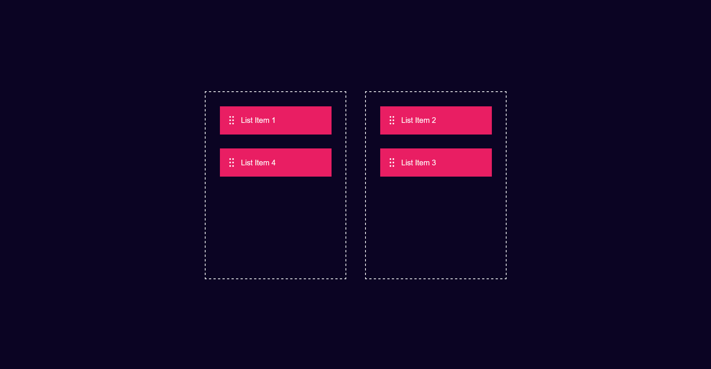

# Drag & Drop

Um projeto simples e interativo para praticar **HTML, CSS e JavaScript**. Arraste os itens entre duas caixas e organize-os como quiser.

## Visual



## Funcionalidades

- Arrastar os itens da lista com o mouse.
- Soltar os itens em qualquer uma das duas caixas.
- Mover os itens de volta para a caixa original.
- Interface com cores contrastantes e áreas de soltar destacadas.

## 🧰 Tecnologias

- **HTML5** - estrutura da página e elementos arrastáveis.
- **CSS3** - layout e aparência.
- **JavaScript** - eventos de arrastar e soltar usando a API nativa do navegador.

## 🚀 Como executar

1. Baixe ou clone este projeto.
2. Abra a pasta `projeto10-drag`.
3. Abra o arquivo `index.html` em um navegador.
4. Arraste um dos itens para a outra caixa.

Não é necessário instalar dependências ou iniciar um servidor.

## 📁 Estrutura do projeto

```text
projeto10-drag/
├── img/
│   └── drag_drop_icon.png
├── index.html
├── script.js
├── style.css
└── README.md
```

## 📚 O que este projeto pratica

- Seleção e manipulação de elementos do DOM.
- Eventos `dragstart`, `dragover` e `drop`.
- Uso de `event.preventDefault()` para permitir que uma área receba itens.
- Organização de uma interface com Flexbox.

---

<p align="center">
  Desenvolvido por <a href="https://github.com/LucMNS"><b>LucMNS</b></a>
</p>